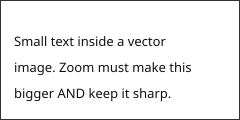

# Image test

Same-dir relative image (220px — must NOT stretch to fill the pane):

Wide image (1600px — must scale down to FIT the pane, never blank; TDD 2.21):

Vector image (240px SVG with text in it — must scale with zoom AND stay sharp; TDD 13.11):

Traversal (must be refused):

Alt text made of MARKUP (TDD 2.5) — nothing below the picture, and no second image:

, a nested  and a raw  tail](logo.png)

Declared size (TDD 2.21b) — `width="100"` (logo at 100 px wide), `height="40px"` (logo 40 px tall, aspect kept), `width="5000"` (wide.png, clamped to the pane), `width="50%"` (ignored: natural size):

